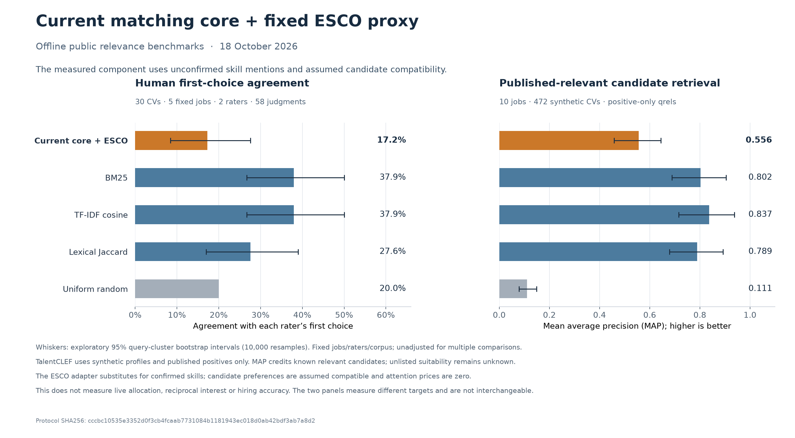

# Measured relevance: 18 October 2026

The current compatibility core, supplied through a fixed ESCO text adapter,
underperforms straightforward text baselines on both evaluated datasets. This
is useful evidence of a relevance weakness. It does **not** establish that live
matching is accurate, nor measure mutual interest or hiring success.

## Presentation wording

> We tested our current compatibility scoring core using a fixed public skill
> adapter. It agreed with a human reviewer's first choice in 17.2% of judgments
> on a small 30-CV benchmark, versus 37.9% for a BM25 baseline. On a second,
> expert-annotated benchmark of synthetic profiles, it achieved MAP 0.556,
> versus 0.802 for BM25 and 0.837 for TF-IDF. These tests identify a relevance
> weakness to address; real mutual-interest and hiring accuracy remain unmeasured.



The two panels measure different tasks. Their values must not be averaged into
one accuracy percentage. The text baselines are comparators, not features added
to the live algorithm or results achieved by it.

## Results

All methods and adapter rules were fixed before these scoring runs, with no
supervised fitting or label-based parameter selection. Lexical comparators
compute unsupervised IDF on their respective indexed documents. These are public development and
exploratory results, rather than an untouched independent holdout. Previously
examined Vanetik baseline results informed source investigation, not parameter
tuning. Both final executions reproduced every dataset result exactly. Two
earlier runs produced the same scores; protocol v2 corrects dataset-specific
index metadata and normalizes source fingerprint line endings, without changing
scoring or parameters.

| Method | Human first-choice agreement | Human pairwise agreement | TalentCLEF MAP | TalentCLEF published-positive P@10 |
| --- | ---: | ---: | ---: | ---: |
| **Current core + fixed ESCO adapter** | **17.2%** | **44.7%** | **0.556** | **69.8%** |
| BM25 | 37.9% | 61.6% | 0.802 | 89.0% |
| TF-IDF cosine | 37.9% | 61.2% | 0.837 | 88.0% |
| Token Jaccard | 27.6% | 49.8% | 0.789 | 88.0% |
| Uniform random expectation | 20.0% | 50.0% | 0.111 | 10.0% |

The current proxy's first-choice agreement has a 95% CV-cluster bootstrap
interval of **8.5–27.6%**. This includes the 20% random expectation; the result
does not establish performance reliably below random. Its TalentCLEF MAP
interval is **0.458–0.644**. TF-IDF's paired MAP advantage is **0.281**, with an
exploratory 95% job-cluster interval of **0.178–0.391**. Intervals use 10,000
resamples, preserve correlated judgments within queries, and make no adjustment
for multiple comparisons. Fixed jobs, raters, corpus selection and adapter
uncertainty limit generalization.

MAP averages how highly each job's published relevant candidates rank.
P@10 here counts published-positive retrieval credit among ten recommendations;
**69.8% is not verified suitability precision or matching accuracy**. Unlisted
TalentCLEF pairs receive no retrieval credit but remain unjudged. There are no
confirmed negative labels from which to calculate classification accuracy or
ROC AUC. Exact expectations over score ties avoid arbitrary ID-based gains.

## Why these sources

- [Vanetik–Kogan vacancy/resume benchmark](https://github.com/NataliaVanetik/vacancy-resume-matching-dataset):
  anonymized CVs with two humans ranking five fixed jobs for each of 30 CVs.
  We preserve the annotated CV-to-jobs direction. Two malformed rows from one
  rater are excluded without guessing repairs, leaving **58 judgments across
  30 CV clusters**. The 580 induced job-pair comparisons are not independent
  examples. The source repository is GPL-3.0; raw documents and rankings remain
  local and are not redistributed here.
- [TalentCLEF 2026 Task A](https://talentclef.github.io/talentclef/docs/talentclef-2026/data/description_corpus/),
  [release 0.3.0](https://zenodo.org/records/19652670): English development data
  has **10 jobs, 472 candidate documents and 472 published positive judgments**,
  evaluated across all 4,720 pairs. Its profiles are privacy-preserving synthetic
  text derived from real-world statistics, with expert relevance annotation;
  they are not observed applicant decisions. The other 4,248 pairs lack explicit
  judgments. This is a development-set retrieval experiment, not an official
  held-out leaderboard submission. Source license: CC BY 4.0.

These sources provide inspectable human relevance labels and complementary
ranking directions. Larger unlabeled resume collections cannot establish
matching accuracy. Public generated labels do not substitute for observed
bilateral decisions. JTH data was not used.

## What was actually scored

The adapter extracts exact official English skill-label token sequences using
all 13,939 released ESCO v1.2.0 concepts and their alternative labels. Ambiguous
token sequences are excluded. Five blank source aliases are discarded and
recorded. The vocabulary was selected without benchmark labels. ESCO content
is attributed to the European Union under its
[content copyright notice](https://esco.ec.europa.eu/en/copyright-notice-esco-skills-competences).

Extracted concepts supply candidate skills and optional vacancy preferences to
the **existing** `skill_coverage` and `score_reciprocal` functions. The three
candidate compatibility inputs are held at one and attention prices at zero,
conditional on hypothetical eligibility. In this experiment relevance therefore
equals `sqrt((1 + skill_coverage) / 2)`; it is a ranking utility, not a probability.
The native missing-preference behavior is retained. Every evaluated document in
both corpora had at least one detected concept.

This adapter is part of the experiment. Text mentions do not establish confirmed
skills; negation, context, experience, seniority and importance are not resolved.
Treating every job skill mention as optional may diverge from a real structured
profile. TalentCLEF has **34.1% tied candidate-pair scores** for this proxy,
consistent with a coarse coverage score. Baselines can use relevant words that
the skill adapter discards. The evaluation cannot isolate adapter error from
core-feature limitations, or establish how a richer structured profile performs.

Eligibility, consent, candidate preferences, attention allocation, double opt-in
and outcomes are absent from these sources. No machine learning model is trained
or activated by this evaluation. The existing outcome-learning pipeline remains
available but has no qualified observed dataset here. A read-only local database
audit found zero profiles, vacancies, introductions and employment outcomes;
the learning-observation table was not present in that local deployment.

## Reproduction and verification

[Aggregate results and fingerprints](evaluations/matching-accuracy-2026-10-18.json)
record all comparators, uncertainty, source checksums, extraction coverage and
the frozen protocol digest. Raw data, per-document hashes and full local run
artifacts stay in ignored `.local/`. Source loaders validate pinned archives,
licensing metadata, inventories, joins and label structure; downloads never
silently replace an existing source. ESCO pages are cached from its official API.

For first-time source acquisition, run the first three commands from the
repository root using the installed research environment. With the reported
sources already cached, run only the final command:

```powershell
.venv-research/Scripts/python.exe -m scripts.matching_text_benchmark --download `
  --output .local/matching-human-benchmark/fresh-source-check
.venv-research/Scripts/python.exe -m scripts.talentclef_source --download
.venv-research/Scripts/python.exe -m scripts.esco_source
.venv-research/Scripts/python.exe -m scripts.benchmark_matching_accuracy `
  --output .local/matching-accuracy/fresh-run
```

Choose new output directories. API access is necessary only for source acquisition;
scoring runs offline. The pinned Vanetik and TalentCLEF downloads deliberately
refuse to overwrite their existing default archives; reuse those cached sources
for offline reruns. A new live API taxonomy acquisition can change manifest
timestamps and therefore the protocol digest even with identical skill content;
compare the content fingerprints as well. The two reported runs used identical
cached sources and code. Source fingerprints normalize CRLF to LF so Git checkout
line endings do not change code identity. Full reports include source-provenance file hashes;
the committed summary omits document and query identifiers.

The 69 added evaluation tests pass, including exhaustive tie-permutation oracles,
hand-calculated metrics, shared candidate pools, malformed sources, unknown-label
handling, frozen protocol integrity and deterministic replay. Ruff formatting,
lint and mypy pass for the full backend/script scope. On this Windows sandbox,
the complete research run passed 409 of 410 tests; the existing symlink-creation
check could not run because Windows denied the required privilege. Its actual
symlink check requires Linux CI. Test temporary files must use a writable
workspace directory:

```powershell
$env:TMP=Join-Path (Get-Location) '.local/accuracy-test-temp'
$env:TEMP=$env:TMP
New-Item -ItemType Directory -Force -Path $env:TMP | Out-Null
$env:PYTHONPATH='apps/api'
.venv-research/Scripts/python.exe -m unittest discover -s tests/research -v
```

No hosted deployment or prospective hiring-accuracy experiment ran for this
measurement. The earlier allocator benchmark measures optimization of supplied
utility; its synthetic optimum rate is not predictive matching accuracy.
