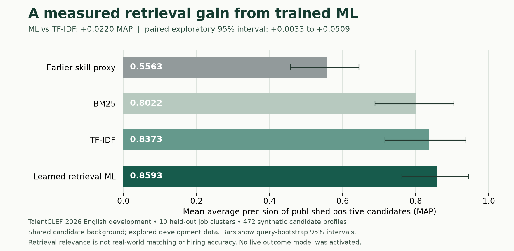

# Trained relevance ML and continual outcome learning

We implemented and actually trained machine learning rankers, tested alternatives,
and expanded the production outcome-learning path. The strongest public retrieval
experiment improves MAP from **0.5563 for the previous skill proxy to 0.8593**.
The stronger TF-IDF comparator already achieves **0.8373**, so the additional
measured gain from the learned retrieval model is **0.0220 MAP**. This is useful
exploratory evidence, not proof of high hiring accuracy.

## What the trained retrieval model learns

The model learns fifteen weights over complementary text matching signals:
normalized BM25, word TF-IDF and sublinear TF-IDF cosine, word and IDF-weighted
coverage in both directions, word-pair overlap, and character n-gram similarity.
The character signals accommodate some spelling and word-form variation;
they do not understand qualifications, negation or a person's intentions.

For each training job, a listwise softmax objective encourages published relevant
candidates to rank above the shared background corpus. Only expert positive
judgments supply targets. Unlisted candidates participate as unlabeled background;
they are **not confirmed unsuitable candidates or rejected introductions**.
Incomplete judgments can bias this surrogate.

Feature means and scales are fitted on training jobs alone. Inner whole-job
validation selects one of five declared regularization strengths and compares
the learned model with TF-IDF. If the learned model loses that inner comparison,
the policy uses TF-IDF. Outer evaluation holds out an entire job and all its
labels from both fitting and selection. The learned model was selected for all
ten outer jobs. Scores are ranking utilities, not calibrated probabilities.

The final portable model uses standard-library JSON inference. Fitting requires
NumPy in the operator/research environment; API inference does not load NumPy,
sklearn, torch, remote executable model code or pickle files.

## Executed retrieval result



The source is [TalentCLEF 2026 Task A English development data](https://zenodo.org/records/19652670):
ten jobs, 472 synthetic candidate profiles and 472 expert positive judgments.
All methods rank the same 472 candidates for each job. The source provides no
explicit negative suitability judgments for the other 4,248 pairs.

| Method | Published-positive MAP | Published-positive P@10 |
| --- | ---: | ---: |
| Previous core + fixed ESCO skill adapter | 0.5563 | 0.6982 |
| BM25 | 0.8022 | 0.8900 |
| TF-IDF cosine | 0.8373 | 0.8800 |
| **Learned retrieval model, outer held-out jobs** | **0.8593** | **0.9000** |
| Human-ordinal model transferred to retrieval, rejected | 0.1125 | 0.1600 |

The learned model's MAP interval is **0.7621–0.9446**. Its paired difference from
TF-IDF is **+0.0220**, with an exploratory 95% job-cluster bootstrap interval of
**+0.0033 to +0.0509**. These intervals condition on the fitted outer predictions;
they do not include retraining uncertainty, adaptive exploration of several model
families, correlated occupations, or selection of these public benchmarks.
They are not adjusted for multiple comparisons.

The candidate corpus is shared across folds as label-free indexing and training
background. This is **transductive evaluation of held-out job labels**, not an
independent candidate holdout. The public development data had already been
examined. Nested validation prevents direct within-run fitting/selection leakage;
it does not turn an explored development source into an untouched external test.
P@10 = 0.90 means published-positive retrieval credit, **not 90% matching accuracy**.

[Aggregate results, protocol and source fingerprints](evaluations/public-retrieval-ml-2026-10-18.json)
include all comparators and the raw learned policy. The final source safety repair
changed contact-redaction complexity and the feature version; every one of
358,650 feature values across both evaluated corpora and the unlabeled test
corpus remained exactly unchanged. No model grid, objective or feature selection
was tuned after observing the outer results.

## Other models were tested and failures retained

A pairwise logistic ranker trained on actual human best-to-worst job preferences
improves held-out-CV pairwise agreement to **62.1%**, compared with **44.7%** for
the earlier skill proxy and **61.2%** for TF-IDF. Its first-choice agreement is
**34.5%**, compared with TF-IDF's **37.9%**. It fails when transferred to the
opposite job-to-candidates retrieval task: MAP **0.1125**. Those weights must not
be promoted. Each CV and both raters remain together in nested validation.

This [human-ranking source](https://github.com/NataliaVanetik/vacancy-resume-matching-dataset)
contains only thirty CVs and five fixed jobs. The raters agree on first choice
for just **5 of 28** shared CVs. Even an oracle choosing one ranking per CV can
match at most **35 of 58 first-choice judgments (60.3%)**. That bound describes
label disagreement; it is not used to normalize accuracy or select the model.

Frozen BGE-small, E5-small and an MS-MARCO MiniLM crossencoder were also run.
Their human first-choice agreement was respectively **20.7%, 29.3% and 15.5%**,
below the 37.9% lexical baseline. A fixed BGE/BM25/TF-IDF fusion achieved retrieval
MAP **0.8460**, but its paired advantage over TF-IDF had interval
**−0.0253 to +0.0495**. These trials do not establish a robust benefit from adding
neural runtime dependencies. All model versions, licenses, comparisons and
limitations remain in the aggregate experiment evidence. No failed model was
quietly substituted for the live scorer.

The [ordinal experiment](evaluations/public-ordinal-ml-2026-10-18.json) and
[frozen neural comparisons](evaluations/frozen-neural-relevance-2026-10-18.json)
retain the failed transfers, source hashes, selected protocols and uncertainty.

## What can improve from real feedback

The production outcome learner now has a versioned seven-field contract rather
than four mostly constant inputs. It captures confirmed skill coverage,
precision, Jaccard overlap, stated role/mode/type compatibility and a bounded
professional-text alignment feature. The text feature is a **fixed deterministic
extractor**, not the public trained retrieval model. It uses only the two
professional texts, fixed contact redaction and TF-IDF cosine. Only its scalar
and extractor-specification digest enter learning snapshots and exports.

Both candidate and organization must opt into learning before text extraction.
Issuance rechecks consent and its planned versions under the registry lock;
revocation or revoke/re-opt-in after planning aborts before exposure persistence.
Edited profiles cannot rewrite old snapshots. A changed extractor digest requires
a reviewed data window/migration; the trainer rejects mixed known extractors.
Contact redaction does not guarantee that free prose contains no personal or
protected information. No anonymity or fairness certification is claimed.

New outcome artifacts use schema 3 with fourteen numeric coefficients, while
schema 2 models remain readable. Training reports feature availability,
missingness, constant inputs and readiness. New models must still beat the
incumbent and all required baselines on separated, forward-time consented
outcomes. Public relevance artifacts have distinct targets and cannot pass the
outcome registry validator.

The new [continual learning controller](continual-matching-learning.md) checks
for new resolutions, trains fresh candidates and can request qualified promotion.
It runs separately from API transactions, uses a database advisory lease, preserves
fresh holdouts and never promotes a rejected model. State must live on one shared
persistent volume. Neither a controller nor a hosted deployment was started by
this change. [Outcome training, consent, rollout and rollback](matching-learning.md)
describe the production requirements.

## Current deployment and accuracy limits

A read-only local audit found zero pair cycles; the default development database
had not yet applied the migration containing outcome observations and the model
registry. Disposable test schemas exercised the complete implementation instead.
There is therefore no qualified real-outcome model to activate here.

The repository instruction requires that **"learned models require consented
outcomes and validated, versioned promotion with a deterministic fallback"**
([AGENTS.md](../AGENTS.md)). Public relevance models do not meet that outcome
requirement. Live matching consequently retains deterministic scoring until a
genuinely qualified outcome model exists. The public ML models have been trained
and measured; real mutual-interest and hiring accuracy remain unmeasured.

Local predictions for the 40-job, 476-candidate unlabeled official test corpus
are prepared in the official six-column TREC format. No server submission or
external test score is claimed. That corpus cannot provide local accuracy
without its hidden judgments.

## Reproduce

After acquiring the pinned public sources as described in the
[original measurement](matching-accuracy-measurement.md), run:

```powershell
$env:PYTHONPATH='apps/api'
.venv-research/Scripts/python.exe -m scripts.benchmark_text_relevance `
  --output .local/ml-reproduce/ordinal --prepare-official-test
.venv-research/Scripts/python.exe -m scripts.benchmark_retrieval_relevance `
  --ordinal-model .local/ml-reproduce/ordinal/public-ordinal-model.json `
  --output .local/ml-reproduce/retrieval
.venv-research/Scripts/python.exe -m scripts.predict_retrieval_relevance `
  --artifact .local/ml-reproduce/retrieval/public-retrieval-model.json `
  --policy-report .local/ml-reproduce/retrieval/report.json `
  --output .local/ml-reproduce/unlabeled-test
```

Choose fresh output directories. Raw documents, relevance judgments, model
weights, per-document predictions and pseudonymized production exports stay in
ignored private storage. Only code and aggregate public experiment results are
committed. Inference tests run with `python -S`; independent derivative and SciPy
oracles verify the numerical solvers. PostgreSQL tests verify the actual consent,
snapshot, registry, rollback, controller and live-executor paths using explicitly
fictional software fixtures. Those fixtures are not matching-accuracy evidence.

Final local verification used a clean source snapshot excluding concurrent work
in the shared checkout: 99 PostgreSQL integration tests and 69 focused inference
tests passed, with 18 additional subtests. Formatting, lint and type checks passed
across all 117 backend/operator/migration modules. The PostgreSQL migration
upgrade/downgrade/upgrade and unchanged OpenAPI contract checks passed. Of 454
research tests, 453 passed locally; the remaining existing symlink test could not
create a link because Windows denied the required privilege. All 23 new relevance
research tests passed separately. GitHub's Linux CI provides the full platform
check on the committed source.
